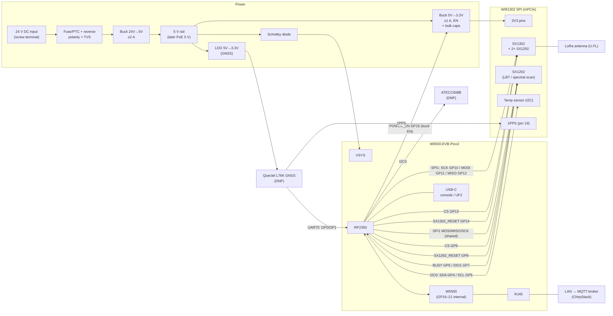
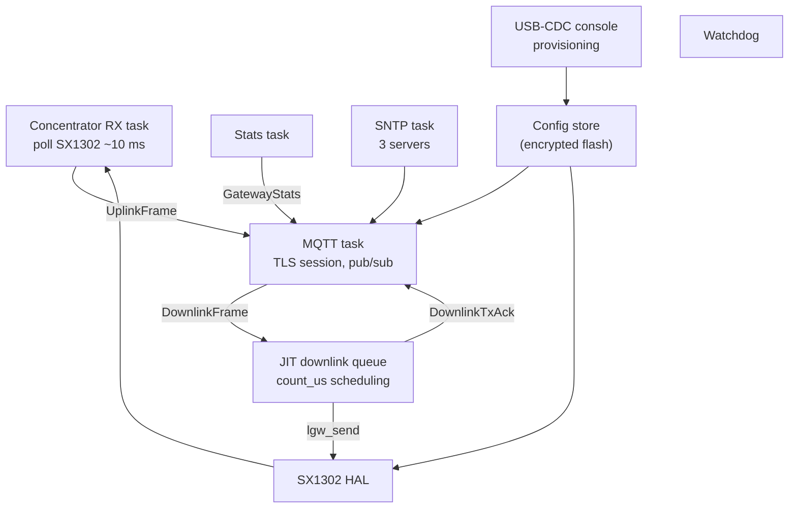

# Low-cost LoRaWAN gateway: WM1302 (SPI) + W5500-EVB-Pico2

Design sketch for a microcontroller-based LoRaWAN gateway that connects directly to
ChirpStack over MQTT/TLS with protobuf payloads. Firmware in Rust.

Status: concept. WM1302 mPCIe pinout verified against the Seeed WM1302 (SPI) EU868
datasheet (section 2.5); do not copy pin numbers from Seeed's Raspberry Pi
`reset_lgw.sh` scripts (known to be inconsistent, and they describe the Pi HAT, not
the module).

---

## 1. Goals and scope

- Class A uplink/downlink, Class C unicast and Class C multicast (scheduling type
  **Delay**). No Class B for now.
- EU868, single WM1302 SPI module (SX1302 + 2x SX1250 + SX1262 for LBT/spectral scan).
- Ethernet only (W5500), optional PoE later via WIZnet PoE module.
- Power: 24 V DC like an industrial PLC (IEC 61131-2 range 19.2–30 V), wide-input
  front end (9–32 V) so 12 V supplies also work.
- Direct connection to ChirpStack's MQTT broker, replacing what Concentratord +
  ChirpStack MQTT Forwarder do on a Linux gateway.
- MQTT authentication: per-gateway username/password, TLS with CA certificate only
  (no client certificate).

---

## 2. Hardware

### 2.1 Components

| Part | Purpose | Notes |
|---|---|---|
| W5500-EVB-Pico2 | MCU (RP2350, 520 KB SRAM, 2 MB flash) + Ethernet | GP16–GP21 are used internally for the W5500 |
| Seeed WM1302 SPI (EU868) | LoRa concentrator, mPCIe 52-pin | SX1302 reset is active HIGH on the SPI version |
| mPCIe socket + standoff/latch | Holds the WM1302 | 52-pin, 0.8 mm pitch |
| Wide-input buck 24 V → 5 V, ≥ 1.5 A | Primary supply (input 9–32 V) | TI LMR38020 (4.2–80 V, 2 A, HSOIC-8), 80 V for surge margin (see 2.4) |
| Input protection | Reverse polarity, surge, overcurrent | P-FET or ideal-diode controller, TVS SM8S33A (6600 W, DO-218AB), PTC/fuse |
| 5 V → 3.3 V buck, ≥ 1 A, with EN | Dedicated supply for the WM1302, switched by POWER_EN | e.g. TPS563201 / AP62300 class |
| 5 V → 3.3 V LDO, high PSRR, fast discharge | Supply for the L76K | e.g. AP2112K-3.3 class; Quectel advises against a DC-DC here |
| Bulk + ceramic caps | TX current peaks | e.g. 2× 100 µF + 10 µF + 100 nF at the socket |
| Schottky diode | 5 V → Pico VSYS | Standard Pico external-supply arrangement |
| ATECC608B (DNP footprint) | Future: mTLS private key in hardware | Same I2C bus as the WM1302 temp sensor |
| Quectel L76K (DNP footprint) | Future: Class B / GPS time | GPS/BeiDou/GLONASS/QZSS, 2.7–3.4 V, ~29 mA, UART + 1PPS, U.FL for GNSS antenna |
| 24 V DC input | Pluggable screw terminal (5.08 mm), later PoE | USB-C on the Pico for console/flashing |

### 2.2 Block diagram (signals and power)



Ground: single common ground between input, buck, Pico and mPCIe socket.

### 2.3 Pin map

| Pico GPIO | Function | Peripheral pin |
|---|---|---|
| GP10 | SPI1 SCK | WM1302 pin 45 SPI_SCK |
| GP11 | SPI1 TX (MOSI) | WM1302 pin 49 SPI_MOSI |
| GP12 | SPI1 RX (MISO) | WM1302 pin 47 SPI_MISO |
| GP13 | CS SX1302 | WM1302 pin 51 SX1302_CSN |
| GP9 | CS SX1262 (GPIO) | WM1302 pin 25 SX1262_CSN |
| GP14 | SX1302_RESET (active high on SPI version) | WM1302 pin 22 RESET |
| GP8 | SX1262_RESET | WM1302 pin 10 SX1262_RST |
| GP6 | SX1262_BUSY (input) | WM1302 pin 8 SX1262_BUSY |
| GP7 | SX1262_DIO1 (input, IRQ) | WM1302 pin 33 SX1262_IO1 |
| — | SX1262_DIO2 | WM1302 pin 31, leave NC |
| GP15 | POWER_EN | EN of the WM1302 3.3 V buck (pull-down, module off at boot) |
| GP4 / GP5 | I2C0 SDA / SCL | WM1302 pins 32 / 30 (temp sensor), ATECC608B (DNP) |
| GP0 / GP1 | UART0 TX / RX | L76K pin 3 RXD / pin 2 TXD (DNP) |
| GP2 | PPS sense (input) | L76K pin 4 1PPS (DNP) |
| GP3 | L76K reset (open-drain: drive low or hi-Z) | L76K pin 9 RESET_N (DNP) |
| GP16–GP21 | — | W5500 (internal, do not use) |

WM1302 mPCIe pins (SPI version, from the Seeed datasheet):

| mPCIe pin | WM1302 signal | Connect to |
|---|---|---|
| 2, 24, 39, 41, 52 | 3V3 | 3.3 V buck output (all five) |
| 4, 9, 15, 18, 21, 26, 27, 29, 34, 35, 37, 40, 43, 50 | GND | Ground plane |
| 19 | 1PPS (input) | L76K 1PPS |
| 14 / 16 | I2C_SCL / I2C_SDA (temp sensor, second pair) | NC (use 30/32) |
| 36 / 38 | USB_D− / USB_D+ | NC (USB version only) |
| others | NC | NC |

The module has **no** power-enable pin; the `SX1302_POWER_EN` in Seeed's scripts
switches a regulator on the Pi HAT. On this board POWER_EN switches the 3.3 V buck.
L76K SET (pin 18) floating = GPS + BeiDou; WAKEUP, ANTON and RESERVED pins NC.

### 2.4 Power notes

- Input: 24 V DC nominal like an industrial PLC; design for 9–32 V continuous so
  IEC 61131-2 (19.2–30 V incl. ripple) and 12 V supplies are covered. Buck rated
  80 V, all parts before the buck (FET, PTC, filter, caps) rated ≥ 100 V.
- Input protection: PTC or fuse, reverse-polarity protection (P-FET / ideal diode,
  avoids the drop of a series diode), TVS SM8S33A after the protection (33 V
  stand-off, stays off at 32 V; see surge check below), input bulk cap + π-filter
  for conducted EMC.
- Surge target: EN 61000-6-2 (industrial immunity), DC power port, IEC 61000-4-5
  ±0.5 kV line-to-line and line-to-earth (1.2/50 µs, 8/20 µs). Levels and the
  applicability footnotes (cable length, DC distribution network) still to be checked
  against the standard text.
- Surge check result: line-to-line the generator source impedance is 2 Ω, so the
  TVS sees up to ~250 A (8/20 µs). SMCJ33A: 155 A at 8/20 µs (Littelfuse product
  page), so it **does not pass**. Its 53.3 V clamp is specified at only 28.2 A
  (10/1000 µs); at 8/20 µs surge currents the clamp is well above that. SM8S33A
  (6600 W, 53.3 V at 124 A 10/1000 µs) carries the current, but its clamp at ~250 A
  is likely at or above 60 V, which would leave a 60 V buck such as the LMR36015
  (60 V operating, 66 V abs. max) no margin.
- Decision: SM8S33A + TI LMR38020 (4.2–80 V, 2 A, HSOIC-8) instead of the LMR36015;
  all parts before the buck rated ≥ 100 V. Rejected: keeping the 60 V buck with a
  two-stage protection (primary TVS, series impedance, secondary TVS); more parts.
- Buck layout and input (from the LMR36015 datasheet; check the values against the
  LMR38020 datasheet, the principles are the same):
  ≥ 4.7 µF ceramic X7R rated 2× V_IN max (100 V) plus 220 nF small-case at each of
  the two VIN/PGND pin pairs; 20–100 µF electrolytic in parallel to damp the cable
  inductance; VCC 1 µF, CBOOT 100 nF; tight input loop, small SW node, feedback
  divider at FB away from SW; 4-layer board with a solid inner GND plane. No
  snap-back (thyristor) TVS on the input (TI: output caps discharge back into it).
  Design the π-filter to TI AN-2162 so it does not destabilise the buck.
- Three rails from the 5 V bus: 24 V → 5 V (Pico VSYS, later PoE 5 V joins here),
  5 V → 3.3 V buck for the WM1302 and 5 V → 3.3 V LDO for the L76K.
- Current budget at 5 V: WM1302 max 415 mA at 3.3 V (datasheet, TX 26 dBm) ≈ 0.3 A,
  Pico 2 + W5500 ≈ 0.15 A, L76K 29 mA. Total ≈ 0.5 A, so the 2 A 24 V → 5 V stage and
  a ≥ 1 A WM1302 buck leave good margin for start-up and TX transients.
- Do **not** power the WM1302 from the Pico's 3V3 pin; use the dedicated buck.
- Place bulk capacitance close to the mPCIe 3.3 V pins for TX peaks.
- Power sequencing: keep all Pico pins towards the WM1302 as inputs / low until the
  module's 3.3 V rail is up (avoid back-powering through I/O). POWER_EN (GP15) drives
  the buck's EN with a pull-down, which also gives a hard power-cycle of the module.
- Feed the Pico through VSYS with a Schottky diode so USB and external 5 V can coexist.

---

## 3. Firmware architecture (Rust)

### 3.1 Stack

| Layer | Choice |
|---|---|
| Runtime / HAL | Embassy, `embassy-rp` (RP2350) |
| Ethernet / IP | `embassy-net-wiznet` (W5500 MACRAW) + `embassy-net` (smoltcp) |
| TLS | `embedded-tls` 0.19 (TLS 1.3 only), feature `rustpki` (P-256 built in), no `webpki`, no `rsa`; chain-pinning verifier wrapper |
| MQTT | no_std client, e.g. `rust-mqtt` |
| Protobuf | `micropb` (no alloc, heapless containers), generated from ChirpStack `api/proto/gw/gw.proto` + `common.proto` |
| Concentrator | Semtech `sx1302_hal` (C) built via `cc`, with a Rust shim for SPI/I2C/delays. Later optionally ported to Rust |
| Config storage | `sequential-storage` KV in a flash partition, AES-GCM encrypted |
| Bootloader / OTA | RP2350 boot ROM: secure boot + partition table A/B + TBYB, no second-stage bootloader |

Reference implementations: ChirpStack Concentratord and ChirpStack MQTT Forwarder
(both Rust, Linux).

Decisions and reasons:

- **TLS (`embedded-tls`)**: TLS 1.3 only, so the broker must offer TLS 1.3
  (Mosquitto with OpenSSL ≥ 1.1.1 does). The broker certificate uses an
  **ECDSA P-256** key: RSA verification needs the `rsa` crate and a global
  allocator, P-256 does not. RP2350 has a SHA-256 accelerator and TRNG; AES-GCM and
  P-256 run in software (handshake time still to be measured on the RP2350).
  Results from a host test against Mosquitto 2.0.11 / OpenSSL 3.0 (P-256 root →
  intermediate → broker certificate, TLS 1.3 only):
  - `webpki` verifier rejected: it pulls in `ring` → `getrandom`, which does not
    build for `thumbv8m.main-none-eabihf`, and it ignores intermediates (end entity
    checked directly against the root). The `rustpki` verifier (`pki::CertVerifier`)
    builds no_std without alloc and walks the chain root → intermediate → leaf
    (signatures, validity dates, hostname via SAN/CN, max. 3 SANs of 64 chars).
  - `rustpki` does **not** check `basicConstraints` / key usage: a certificate
    signed by any ordinary (CA:FALSE) leaf from the same CA was accepted. Fix: a
    small wrapper verifier that only accepts `[leaf]` or `[leaf, pinned
    intermediate]` (optionally followed by the root itself) and then delegates to
    `pki::CertVerifier`; it rejected the forged chain in the test. In addition,
    use a dedicated CA for the broker only. Reporting the missing check upstream
    is worthwhile.
  - Negative tests passed: wrong hostname, unknown root, forged chain → all
    `InvalidCertificate`.
  - Record buffers: with `with_max_fragment_length(Bits12)` (4096 B, honoured by
    OpenSSL) 2 × 4352 B buffers carried a 10 KB broker → device message; without
    MFL the same 4 KB buffers failed with `InsufficientSpace`. So use MFL 4096 and
    2 × 4352 B instead of 2 × 16 KB.
  - RAM: `TlsConnection` 1.3 KB + verifier with `CERT_SIZE` 2048 2.6 KB + buffers
    8.5 KB ≈ 12.5 KB (host sizes, 64-bit). The test chain is ~0.9 KB DER, so
    `CERT_SIZE` 2048 is enough.
  - If the clock is unknown (`TlsClock::now()` returns `None`), `rustpki` skips the
    validity check; this ties into the time policy in section 6.
- **Protobuf (`micropb`)**: no allocator in the whole firmware, bounded memory per
  message. `prost` would need `alloc` only for this; rejected. Generation tested
  with `micropb-gen` 0.6 + vendored `protoc` (`protoc-bin-vendored`, no system
  install):
  - Builds no_std for `thumbv8m.main-none-eabihf`. Interop checked both ways: a
    `DownlinkFrame` encoded by `protoc` decodes correctly (2 items, LoRa modulation,
    delay timing), and an `UplinkFrame` encoded by micropb decodes cleanly with
    `protoc --decode`.
  - Needed: `retain_enum_prefix(true)` (prefix stripping panics on one of the
    ChirpStack enums), compile `timestamp.proto` + `duration.proto` but not
    `struct.proto` (recursive `Value`, imported but unused by gw.proto).
  - Capacities: default 32 B for string/bytes and 4 for repeated/map;
    `phy_payload` 256 B, `context` 16 B, stats per-frequency/per-status maps 16
    (heapless `FnvIndexMap` needs a power of two), per-modulation lists 8,
    `GatewayConfiguration.channels` 16, `DownlinkFrame.items` 4. Deprecated
    `*_legacy` fields skipped; the decoder ignores them on the wire.
  - Resulting struct sizes (host): `UplinkFrame` 920 B, `DownlinkFrame` 1.7 KB,
    `GatewayStats` 3.4 KB, `GatewayConfiguration` 1.3 KB, `DownlinkTxAck` 72 B.
  - Over MQTT only `UplinkFrame`, `GatewayStats`, `DownlinkTxAck`, `ConnState`
    (out) and `DownlinkFrame`, `GatewayConfiguration` (in) are used; `Event` /
    `Command` are the Concentratord ZMQ wrappers.
- **OTA (boot ROM A/B)**: secure boot is already planned with the key hash in OTP,
  so the boot ROM verifies the signature. Two partitions in the partition table,
  the new image is written to the inactive one and booted as TBYB ("try before you
  buy"); the firmware calls `explicit_buy` only after a successful broker
  connection, otherwise the watchdog reboot falls back to the old slot. Address
  translation maps either slot to the same XIP address, so one binary fits both.
  `embassy-boot-rp` would add a second bootloader and a second signing scheme on
  top of the ROM; rejected.
  `embassy-rp` 0.10 support (checked in the source):
  - `rom_data` binds everything needed: `explicit_buy`, `get_b_partition`,
    `pick_ab_parition`, `get_partition_table_info`, `flash_op`, `reboot`,
    `flash_runtime_to_storage_addr`. `block.rs` builds IMAGE_DEF and partition
    table blocks.
  - `ImageDef` has no TBYB builder, but the flag works by hand:
    `ImageDef::new([item_image_type_exe(Security::Secure, Architecture::Arm) |
    ((IMAGE_TYPE_TBYB as u32) << 16)])` (compiles together with the
    `explicit_buy` call).
  - `Flash::blocking_erase` / `blocking_write` take physical offsets (ROM
    `flash_range_*`), so writing the inactive slot and the config partition works.
    `Flash::blocking_read` reads through XIP at `0x10000000 + offset`, which the
    ROM's address translation maps to the running slot, so it does **not** read
    physical offsets. Read the inactive slot and the config partition with ROM
    `flash_op` (or an extra translation window); wrap that as an
    `embedded-storage` driver for `sequential-storage`. Verify on hardware.
  - After writing the new image: `reboot` with the FLASH_UPDATE type and the slot
    address (define the flag constant ourselves; embassy-rp only has BOOTSEL).
  - Partition table (2 MB flash, 4 KB sectors), created with picotool:

    | Range | Size | Use |
    |---|---|---|
    | `0x000000–0x001FFF` | 8 KB | partition table (unpartitioned) |
    | `0x002000–0x0F8FFF` | 988 KB | slot A (exe) |
    | `0x0F9000–0x1EFFFF` | 988 KB | slot B (exe, linked to A) |
    | `0x1F0000–0x1FFFFF` | 64 KB | config (`sequential-storage` KV, CA slots), no execute |

    Firmware linked at `0x10000000` with FLASH length 988 KB.

### 3.2 Tasks



Optional: radio tasks on core 1, network/TLS on core 0.

### 3.3 ChirpStack MQTT protocol

Topic prefix e.g. `eu868`, gateway ID = SX1302 EUI (hex).

| Direction | Topic | Message |
|---|---|---|
| publish | `eu868/gateway/<id>/event/up` | `UplinkFrame` |
| publish | `eu868/gateway/<id>/event/stats` | `GatewayStats` (include config/cert metadata) |
| publish | `eu868/gateway/<id>/event/ack` | `DownlinkTxAck` |
| publish (retained) | `eu868/gateway/<id>/state/conn` | `ConnState` ONLINE; Last Will = OFFLINE |
| subscribe | `eu868/gateway/<id>/command/down` | `DownlinkFrame` |
| subscribe | `eu868/gateway/<id>/command/config` | optional, gateway configuration |

Downlink timing support:

- **Delay** (Class A): uplink `context` carries the SX1302 1 MHz counter value;
  TX at `count_us + delay`.
- **Immediately** (Class C unicast and Class C multicast with scheduling type Delay).
- **GPS epoch**: not supported until a GPS is fitted (reject with proper ack status).

JIT queue must reject collisions and too-late frames and report the matching
`DownlinkTxAck` status. Track airtime per sub-band and enforce EU868 duty cycle
(important for RX2 869.525 MHz / FUOTA bursts), ack with `DUTY_CYCLE_OVERFLOW`.

---

## 4. Security

### 4.1 MQTT authentication

- TLS 1.3 to the broker; device verifies the broker certificate against a stored CA
  and checks the hostname (SNI). Mosquitto must allow TLS 1.3.
- Dedicated P-256 CA for the broker certificate only; the device accepts only the
  pinned chain shape (see 3.1, TLS). The broker certificate has ≤ 3 SANs.
- Per-gateway username (= gateway ID) and unique password.
- Mosquitto ACL (dynamic-security plugin or acl_file), least privilege:

```
pattern write eu868/gateway/%u/event/#
pattern write eu868/gateway/%u/state/#
pattern read  eu868/gateway/%u/command/#
```

A compromised gateway only exposes its own topics; revoke a single user.

### 4.2 Credential storage on the RP2350

- Secure boot enabled (public key hash in OTP), SWD disabled via OTP.
- Random per-device AES key in an OTP page; firmware reads it at boot and soft-locks
  the page until reset.
- Config blob (credentials, broker, channel plan) encrypted with AES-GCM in flash.
- CA certificate needs integrity, not secrecy: compiled into the signed image and/or
  stored as signed config.
- Limitation: physical attacker with fault-injection equipment may still extract
  secrets. Acceptable for this threat model.

### 4.3 ATECC608B (future)

Not useful for passwords (the MCU must have the password in clear text to send it).
Becomes useful when moving to mTLS: key generated inside the chip, CSR signed by the
same CA used by ChirpStack/Mosquitto, signing routed from `embedded-tls` to the chip.
Keep a DNP footprint on the PCB.

---

## 5. Updates and lifecycle

### 5.1 Firmware

- Every image signed with `picotool seal --sign` (boot ROM, secp256k1 + SHA-256);
  signing key kept offline.
- OTA via boot ROM A/B partitions (988 KB each in 2 MB flash, 64 KB config, see 3.1),
  TBYB boot, `explicit_buy` only after successful broker connection, otherwise
  roll back (see 3.1).
- Anti-rollback version in OTP; up to four boot keys allow key rotation.
- USB BOOTSEL/UF2 stays enabled as recovery path (only signed images boot).

### 5.2 Username / password change

- Locally via USB console (optionally PIN / button).
- Remotely via a command topic (only ChirpStack/admin may publish to `command/`).
- Two-phase: store new alongside old → reconnect with new → commit on success,
  fall back on failure.

### 5.3 CA certificate rotation

- Trust store with multiple slots ("current" + "next"); roll out new CA long before
  switching the broker. A pinned intermediate rotates the same way (slot per CA
  holds root + optional intermediate).
- New CA only via signed firmware or signed config message, never accepted unsigned
  over MQTT.
- If the CA expired before rotation: USB recovery.

### 5.4 Recovery

- If the OTP key or config is lost/corrupt, device boots into provisioning mode;
  re-provision via USB console. Build and test this path from day one.

---

## 6. Time

- Class A and Class C need no GPS/PPS: downlinks use the SX1302 counter or
  "immediately".
- SNTP client with three servers (discard outlier) for TLS validity checks, logs and
  approximate UTC on uplinks (correlate SX1302 counter with RP2350 timer in software).
- A PIO-generated PPS from NTP gives no benefit (accuracy limited by NTP over
  W5500/SPI, ~0.1–several ms, far from Class B requirements).
- Optional Quectel L76K footprint (1PPS → WM1302 GPS_PPS, UART → Pico) for future
  Class B, GPS-time multicast and time without network. Needs sky view.
- L76K notes (Quectel L76K Hardware Design V1.0):
  - VCC 2.7–3.4 V from its own LDO (high PSRR, fast discharge, supply ≥ 100 mA),
    ripple < 100 mV, rise < 40 ms; TVS + 10 µF / 100 nF / 33 pF at the pin. Quectel
    advises against a switching supply, so not from the Pico 3V3 rail.
  - V_BCKP must come up at the same time as or before VCC. Without it every start is
    a cold start (~30 s TTFF instead of 2 s). Decision: supercap on V_BCKP, charged
    from the L76K LDO output via diode + 1 kΩ (Quectel reference circuit). No
    battery to replace; bridges short power cuts. DNP 0 Ω to VCC as fallback.
  - Supercap sizing (L76K Hardware Design V1.0): V_BCKP 1.4–3.6 V (abs. max 3.6 V),
    backup mode 8 µA; 4.7 µF + 100 nF + 33 pF at the pin. Charged to ~3.0 V
    (3.3 V minus Schottky drop), usable ΔV = 3.0 − 1.4 = 1.6 V. Hold time
    t = C · ΔV / I: 0.22 F → ~12 h, **0.47 F → ~26 h** (minus the supercap's own
    leakage). Choice: 0.47 F, rated ≥ 3.3 V, leakage ≤ 2 µA; check the leakage in the
    part's datasheet because it is in the same range as the 8 µA load. Charging
    through 1 kΩ: τ = 470 s, ~25 min to full; initial 3 mA from the LDO is fine.
    Measure the real backup current on the board.
  - I/O level = VCC (3.3 V), connects directly to the RP2350. UART 9600–115200 baud,
    no flow control; default rate depends on firmware version (Waveshare documents
    9600). Firmware probes 9600 then 115200 until valid NMEA arrives, then
    sets the rate with `$PCAS01`. Configuration via `$PCAS` sentences (no PMTK).
  - 1PPS: rising edge, 100 ms pulse, < 30 ns (1σ). Goes to WM1302 pin 19 and GP2.
  - RESET_N active low, ≥ 100 ms, internal pull-up; no external pull-up allowed, so
    drive it open-drain (OC transistor or GPIO switched between low and input).
  - Active antenna: powered from VDD_RF (= VCC) through 68 nH + 0 Ω into RF_IN, DC
    block 100 pF, ESD diode at the connector, π-match footprint (0 Ω, 2× NM).
    Antenna total gain < 17 dB, NF < 1.5 dB. Passive antenna only if cable < 1 m.
- Policy to decide: behaviour when time sync fails (refuse TLS vs. skip date check).

---

## 7. Provisioned configuration

| Key | Example | Notes |
|---|---|---|
| `gateway_id` | read from SX1302 EUI | Read-only, register in ChirpStack |
| `mqtt.host` / `mqtt.port` | `mqtt.example.org` / 8883 | |
| `mqtt.topic_prefix` | `eu868` | |
| `mqtt.username` / `mqtt.password` | gateway ID / random | Encrypted |
| `tls.ca[0..1]` | DER | Current + next CA |
| `ntp.servers` | 3 entries | |
| `radio.region` / channel plan | EU868 8+1+1 | Radio centre freqs, IF offsets |
| `radio.rssi_offset`, TX gain LUT | from WM1302 reference config | Board-specific |
| `radio.antenna_gain` | dBi | For EIRP limits |
| `location` | lat/lon/alt | Static, reported in stats |

---

## 8. Roadmap

1. Connector PCB: 24 V input stage, mPCIe socket, bucks, pin map, DNP footprints
   (L76K, ATECC608B).
2. Bring-up: SPI to SX1302, read chip version and EUI from Rust.
3. `sx1302_hal` via `cc` + shim; receive uplinks, print to USB console.
4. Ethernet + SNTP + TLS + MQTT; publish `UplinkFrame`, `ConnState`, `GatewayStats`.
5. JIT queue: Class A delay downlinks + `DownlinkTxAck`.
6. Class C unicast + Class C multicast (Delay), duty-cycle tracking; FUOTA test.
7. Config store + encryption, USB provisioning, remote credential change.
8. Secure boot, OTP key, signed A/B OTA, CA rotation.

## 9. Open points

- Measure WM1302 3.3 V current at max TX power on the real board (datasheet: 415 mA)
  and confirm bulk capacitance.
- Check the EN 61000-6-2 DC-port surge levels and footnotes against the standard
  text; get the SM8S33A clamp voltage at 8/20 µs (must stay below 80 V); take the
  LMR38020 input/layout values from its datasheet.
- Pick the 0.47 F V_BCKP supercap part (leakage ≤ 2 µA); measure backup current.
- Measure the TLS handshake time on the RP2350 (P-256 in software); confirm RAM.
- Report the missing `basicConstraints` check to `embedded-tls`.
- Implement the `flash_op`-based read driver for the inactive slot and the config
  partition; test TBYB update, `explicit_buy` and roll-back on hardware.
