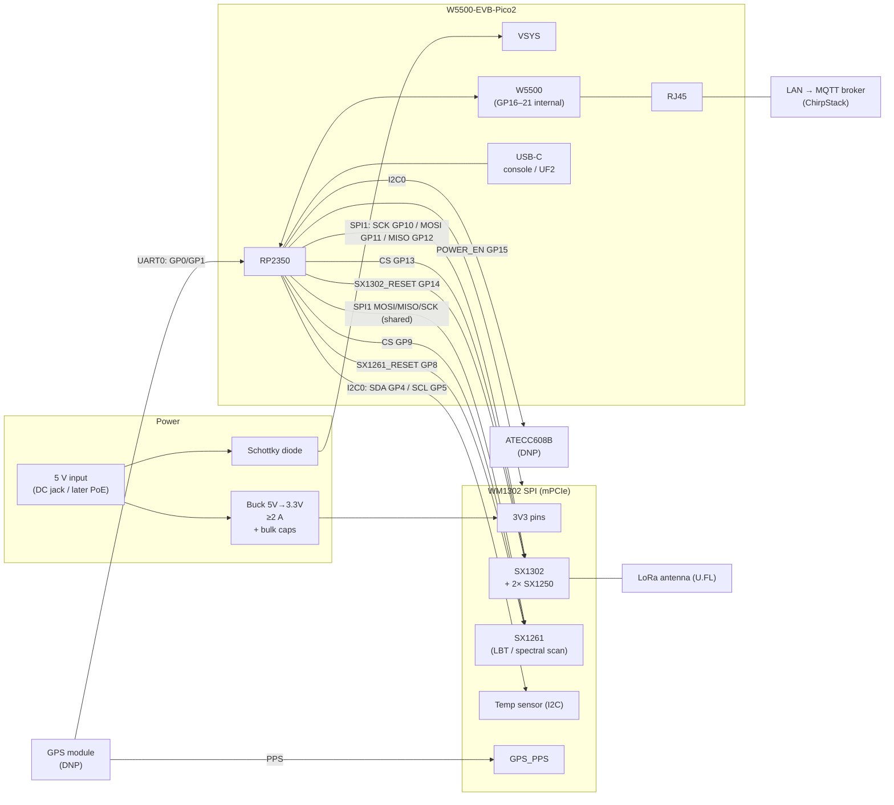
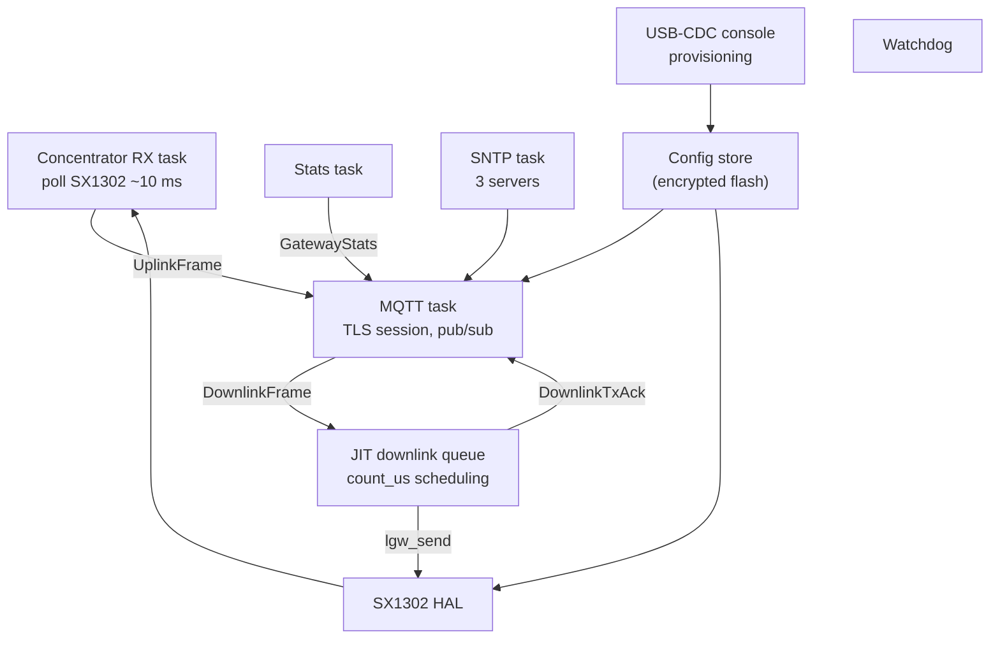

# Low-cost LoRaWAN gateway: WM1302 (SPI) + W5500-EVB-Pico2

Design sketch for a microcontroller-based LoRaWAN gateway that connects directly to
ChirpStack over MQTT/TLS with protobuf payloads. Firmware in Rust.

Status: concept. All WM1302 mPCIe pin numbers must be verified against the WM1302
datasheet; do not copy them from Seeed's Raspberry Pi `reset_lgw.sh` scripts (known
to be inconsistent).

---

## 1. Goals and scope

- Class A uplink/downlink, Class C unicast and Class C multicast (scheduling type
  **Delay**). No Class B for now.
- EU868, single WM1302 SPI module (SX1302 + 2x SX1250 + SX1261).
- Ethernet only (W5500), optional PoE later via WIZnet PoE module.
- Direct connection to ChirpStack's MQTT broker, replacing what Concentratord +
  ChirpStack MQTT Forwarder do on a Linux gateway.
- MQTT authentication: per-gateway username/password, TLS with CA certificate only
  (no client certificate).

---

## 2. Hardware

### 2.1 Components

| Part | Purpose | Notes |
|---|---|---|
| W5500-EVB-Pico2 | MCU (RP2350, 520 KB SRAM, 2 MB flash) + Ethernet | GP16–GP21 are used internally for the W5500 |
| Seeed WM1302 SPI (EU868) | LoRa concentrator, mPCIe 52-pin | SX1302 reset is active HIGH on the SPI version |
| mPCIe socket + standoff/latch | Holds the WM1302 | 52-pin, 0.8 mm pitch |
| 5 V → 3.3 V buck, ≥ 2 A | Dedicated supply for the WM1302 | e.g. TPS563201 / AP62300 class |
| Bulk + ceramic caps | TX current peaks | e.g. 2× 100 µF + 10 µF + 100 nF at the socket |
| Schottky diode | 5 V → Pico VSYS | Standard Pico external-supply arrangement |
| ATECC608B (DNP footprint) | Future: mTLS private key in hardware | Same I2C bus as the WM1302 temp sensor |
| GPS module (DNP footprint) | Future: Class B / GPS time | e.g. u-blox MAX-M10S or ATGM336H |
| 5 V input | Barrel jack / screw terminal (later PoE) | USB-C on the Pico for console/flashing |

### 2.2 Block diagram (signals and power)



Ground: single common ground between input, buck, Pico and mPCIe socket.

### 2.3 Proposed pin map (Pico side)

| Pico GPIO | Function | WM1302 / peripheral |
|---|---|---|
| GP10 | SPI1 SCK | SPI_SCK |
| GP11 | SPI1 TX (MOSI) | SPI_MOSI |
| GP12 | SPI1 RX (MISO) | SPI_MISO |
| GP13 | CS SX1302 | SX1302 CSn |
| GP9 | CS SX1261 (GPIO) | SX1261 CSn |
| GP14 | SX1302_RESET (active high) | SX1302 reset |
| GP15 | POWER_EN | Module power enable |
| GP8 | SX1261_RESET | SX1261 reset |
| GP4 / GP5 | I2C0 SDA / SCL | Temp sensor, ATECC608B (DNP) |
| GP0 / GP1 | UART0 TX / RX | GPS (DNP) |
| GP2 | Optional PPS sense | GPS PPS (DNP) |
| GP16–GP21 | — | W5500 (internal, do not use) |

### 2.4 Power notes

- Do **not** power the WM1302 from the Pico's 3V3 pin; use the dedicated buck.
- Place bulk capacitance close to the mPCIe 3.3 V pins for TX peaks.
- Power sequencing: keep all Pico pins towards the WM1302 as inputs / low until the
  module's 3.3 V rail is up (avoid back-powering through I/O). Optionally let the Pico
  drive the buck's EN pin for a hard power-cycle of the module.
- Feed the Pico through VSYS with a Schottky diode so USB and external 5 V can coexist.

---

## 3. Firmware architecture (Rust)

### 3.1 Stack

| Layer | Choice |
|---|---|
| Runtime / HAL | Embassy, `embassy-rp` (RP2350) |
| Ethernet / IP | `embassy-net-wiznet` (W5500 MACRAW) + `embassy-net` (smoltcp) |
| TLS | `embedded-tls` (TLS 1.3, CA verification only) |
| MQTT | no_std client, e.g. `rust-mqtt` |
| Protobuf | Generated from ChirpStack `api/proto/gw/gw.proto` + `common.proto` (`prost` + alloc, or `micropb`) |
| Concentrator | Semtech `sx1302_hal` (C) built via `cc`, with a Rust shim for SPI/I2C/delays. Later optionally ported to Rust |
| Config storage | `sequential-storage` KV in a flash partition, AES-GCM encrypted |
| Bootloader / OTA | RP2350 secure boot + A/B (boot ROM partitions/TBYB or `embassy-boot-rp`) |

Reference implementations: ChirpStack Concentratord and ChirpStack MQTT Forwarder
(both Rust, Linux).

### 3.2 Tasks



Optional: radio tasks on core 1, network/TLS on core 0.

### 3.3 ChirpStack MQTT protocol

Topic prefix e.g. `eu868`, gateway ID = SX1302 EUI (hex).

| Direction | Topic | Message |
|---|---|---|
| publish | `eu868/gateway/<id>/event/up` | `UplinkFrame` |
| publish | `eu868/gateway/<id>/event/stats` | `GatewayStats` (include config/cert metadata) |
| publish | `eu868/gateway/<id>/event/ack` | `DownlinkTxAck` |
| publish (retained) | `eu868/gateway/<id>/state/conn` | `ConnState` ONLINE; Last Will = OFFLINE |
| subscribe | `eu868/gateway/<id>/command/down` | `DownlinkFrame` |
| subscribe | `eu868/gateway/<id>/command/config` | optional, gateway configuration |

Downlink timing support:

- **Delay** (Class A): uplink `context` carries the SX1302 1 MHz counter value;
  TX at `count_us + delay`.
- **Immediately** (Class C unicast and Class C multicast with scheduling type Delay).
- **GPS epoch**: not supported until a GPS is fitted (reject with proper ack status).

JIT queue must reject collisions and too-late frames and report the matching
`DownlinkTxAck` status. Track airtime per sub-band and enforce EU868 duty cycle
(important for RX2 869.525 MHz / FUOTA bursts), ack with `DUTY_CYCLE_OVERFLOW`.

---

## 4. Security

### 4.1 MQTT authentication

- TLS 1.3 to the broker; device verifies the broker certificate against a stored CA
  and checks the hostname (SNI). Mosquitto must allow TLS 1.3.
- Per-gateway username (= gateway ID) and unique password.
- Mosquitto ACL (dynamic-security plugin or acl_file), least privilege:

```
pattern write eu868/gateway/%u/event/#
pattern write eu868/gateway/%u/state/#
pattern read  eu868/gateway/%u/command/#
```

A compromised gateway only exposes its own topics; revoke a single user.

### 4.2 Credential storage on the RP2350

- Secure boot enabled (public key hash in OTP), SWD disabled via OTP.
- Random per-device AES key in an OTP page; firmware reads it at boot and soft-locks
  the page until reset.
- Config blob (credentials, broker, channel plan) encrypted with AES-GCM in flash.
- CA certificate needs integrity, not secrecy: compiled into the signed image and/or
  stored as signed config.
- Limitation: physical attacker with fault-injection equipment may still extract
  secrets. Acceptable for this threat model.

### 4.3 ATECC608B (future)

Not useful for passwords (the MCU must have the password in clear text to send it).
Becomes useful when moving to mTLS: key generated inside the chip, CSR signed by the
same CA used by ChirpStack/Mosquitto, signing routed from `embedded-tls` to the chip.
Keep a DNP footprint on the PCB.

---

## 5. Updates and lifecycle

### 5.1 Firmware

- Every image signed (`picotool seal --sign` or embassy-boot signing); signing key
  kept offline.
- OTA via A/B slots (~900 KB each in 2 MB flash), confirm only after successful
  broker connection, otherwise roll back.
- Anti-rollback version in OTP; up to four boot keys allow key rotation.
- USB BOOTSEL/UF2 stays enabled as recovery path (only signed images boot).

### 5.2 Username / password change

- Locally via USB console (optionally PIN / button).
- Remotely via a command topic (only ChirpStack/admin may publish to `command/`).
- Two-phase: store new alongside old → reconnect with new → commit on success,
  fall back on failure.

### 5.3 CA certificate rotation

- Trust store with multiple slots ("current" + "next"); roll out new CA long before
  switching the broker.
- New CA only via signed firmware or signed config message, never accepted unsigned
  over MQTT.
- If the CA expired before rotation: USB recovery.

### 5.4 Recovery

- If the OTP key or config is lost/corrupt, device boots into provisioning mode;
  re-provision via USB console. Build and test this path from day one.

---

## 6. Time

- Class A and Class C need no GPS/PPS: downlinks use the SX1302 counter or
  "immediately".
- SNTP client with three servers (discard outlier) for TLS validity checks, logs and
  approximate UTC on uplinks (correlate SX1302 counter with RP2350 timer in software).
- A PIO-generated PPS from NTP gives no benefit (accuracy limited by NTP over
  W5500/SPI, ~0.1–several ms, far from Class B requirements).
- Optional GPS footprint (PPS → WM1302 GPS_PPS, UART → Pico) for future Class B,
  GPS-time multicast and time without network. Needs sky view.
- Policy to decide: behaviour when time sync fails (refuse TLS vs. skip date check).

---

## 7. Provisioned configuration

| Key | Example | Notes |
|---|---|---|
| `gateway_id` | read from SX1302 EUI | Read-only, register in ChirpStack |
| `mqtt.host` / `mqtt.port` | `mqtt.example.org` / 8883 | |
| `mqtt.topic_prefix` | `eu868` | |
| `mqtt.username` / `mqtt.password` | gateway ID / random | Encrypted |
| `tls.ca[0..1]` | DER | Current + next CA |
| `ntp.servers` | 3 entries | |
| `radio.region` / channel plan | EU868 8+1+1 | Radio centre freqs, IF offsets |
| `radio.rssi_offset`, TX gain LUT | from WM1302 reference config | Board-specific |
| `radio.antenna_gain` | dBi | For EIRP limits |
| `location` | lat/lon/alt | Static, reported in stats |

---

## 8. Roadmap

1. Connector PCB: mPCIe socket, buck, pin map, DNP footprints (GPS, ATECC608B).
2. Bring-up: SPI to SX1302, read chip version and EUI from Rust.
3. `sx1302_hal` via `cc` + shim; receive uplinks, print to USB console.
4. Ethernet + SNTP + TLS + MQTT; publish `UplinkFrame`, `ConnState`, `GatewayStats`.
5. JIT queue: Class A delay downlinks + `DownlinkTxAck`.
6. Class C unicast + Class C multicast (Delay), duty-cycle tracking; FUOTA test.
7. Config store + encryption, USB provisioning, remote credential change.
8. Secure boot, OTP key, signed A/B OTA, CA rotation.

## 9. Open points

- Verify WM1302 mPCIe pinout (3V3, SPI, CS for SX1302/SX1261, resets, POWER_EN, I2C,
  PPS) against datasheet.
- Measure WM1302 3.3 V peak current at max TX power; size buck and caps.
- Confirm `embedded-tls` interop with the broker (TLS 1.3, cipher suites, cert type).
- Decide protobuf crate (`prost` + alloc vs. `micropb`).
- Decide OTA mechanism (boot ROM A/B vs. `embassy-boot-rp`).
