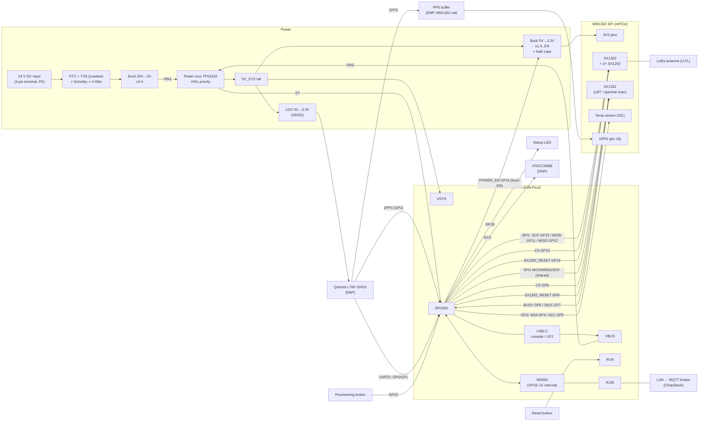
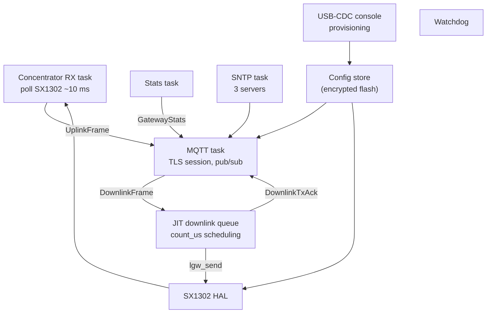

# Low-cost LoRaWAN gateway: WM1302 (SPI) + W5500-EVB-Pico2

Design sketch for a microcontroller-based LoRaWAN gateway that connects directly to
ChirpStack over MQTT/TLS with protobuf payloads. Firmware in Rust.

Status: concept. WM1302 mPCIe pinout verified against the Seeed WM1302 (SPI) EU868
datasheet (section 2.5); do not copy pin numbers from Seeed's Raspberry Pi
`reset_lgw.sh` scripts (known to be inconsistent, and they describe the Pi HAT, not
the module).

---

## 1. Goals and scope

- Class A uplink/downlink, Class C unicast and Class C multicast (scheduling type
  **Delay**). No Class B for now.
- EU868, single WM1302 SPI module (SX1302 + 2x SX1250 + SX1262 for LBT/spectral scan).
- Ethernet only (W5500). No PoE in the first board revision.
- Power: 24 V DC like an industrial PLC (IEC 61131-2 range 19.2–30 V), wide-input
  front end (9–32 V) so 12 V supplies also work. USB power alone runs the whole board
  (incl. WM1302) for provisioning on the desk.
- Direct connection to ChirpStack's MQTT broker, replacing what Concentratord +
  ChirpStack MQTT Forwarder do on a Linux gateway.
- MQTT authentication: per-gateway username/password, TLS with CA certificate only
  (no client certificate).

---

## 2. Hardware

### 2.1 Components

| Part | Purpose | Notes |
|---|---|---|
| W5500-EVB-Pico2 | MCU (RP2350, 520 KB SRAM, 2 MB flash) + Ethernet | GP16–GP21 are used internally for the W5500 |
| Seeed WM1302 SPI (EU868) | LoRa concentrator, mPCIe 52-pin | SX1302 reset is active HIGH on the SPI version |
| mPCIe socket + standoff/latch | Holds the WM1302 | 52-pin, 0.8 mm pitch |
| Wide-input buck 24 V → 5 V, ≥ 1.5 A | Primary supply (input 9–32 V) | TI LMR38020SDDAR (4.2–80 V, 85 V abs. max, 2 A, HSOIC-8, PFM + spread spectrum), 80 V for surge margin (see 2.4) |
| Input protection | Reverse polarity, surge, overcurrent | PTC 60 V + TVS SM8S33A (6600 W, DO-218AB) as crowbar + series Schottky 100 V, π-filter (see 2.4) |
| 5 V → 3.3 V buck, ≥ 1 A, with EN | Dedicated supply for the WM1302, switched by POWER_EN | TI TPS563201 (3 A, 4.5–17 V, EN with internal pull-down) |
| 5 V → 3.3 V LDO, high PSRR, fast discharge | Supply for the L76K | TI TLV75533PDBVR (500 mA, active output discharge); Quectel advises against a DC-DC here |
| Bulk + ceramic caps | TX current peaks | Limited by the TPS563201 (20–68 µF total output capacitance, see 2.4) |
| Power mux | 5 V from the 24 V buck (priority) or USB VBUS → 5V_SYS | TI TPS2116 (1.6–5.5 V, 2.5 A, 40 mΩ, reverse blocking, ST flag); replaces the VSYS Schottky (see 2.4) |
| ATECC608B (DNP footprint) | Future: mTLS private key in hardware | Same I2C bus as the WM1302 temp sensor, powered from the WM1302 3.3 V rail |
| Quectel L76K (DNP footprint) | Future: Class B / GPS time | GPS/BeiDou/GLONASS/QZSS, 2.7–3.4 V, ~29 mA, UART + 1PPS, U.FL for GNSS antenna |
| PPS buffer (DNP) | L76K 1PPS → WM1302 pin 19 without back-powering | SN74LVC1G17 (Schmitt buffer, I_off), powered from the WM1302 3.3 V rail |
| Status LED | One LED, states as blink patterns | GPIO-driven, visible from outside (light pipe) |
| Buttons | Provisioning (GPIO) and reset (Pico RUN) | Tactile switches |
| 24 V DC input | Pluggable screw terminal (5.08 mm), 3-pin: +24 V, 0 V, FE | USB-C on the Pico for console/flashing/desk power |

### 2.2 Block diagram (signals and power)



Ground: single common ground between input, buck, Pico and mPCIe socket, tied to the
FE terminal (see 2.4).

### 2.3 Pin map

| Pico GPIO | Function | Peripheral pin |
|---|---|---|
| GP10 | SPI1 SCK | WM1302 pin 45 SPI_SCK |
| GP11 | SPI1 TX (MOSI) | WM1302 pin 49 SPI_MOSI |
| GP12 | SPI1 RX (MISO) | WM1302 pin 47 SPI_MISO |
| GP13 | CS SX1302 | WM1302 pin 51 SX1302_CSN |
| GP9 | CS SX1262 (GPIO) | WM1302 pin 25 SX1262_CSN |
| GP14 | SX1302_RESET (active high on SPI version), external pull-down | WM1302 pin 22 RESET |
| GP8 | SX1262_RESET | WM1302 pin 10 SX1262_RST |
| GP6 | SX1262_BUSY (input) | WM1302 pin 8 SX1262_BUSY |
| GP7 | SX1262_DIO1 (input, IRQ) | WM1302 pin 33 SX1262_IO1 |
| — | SX1262_DIO2 | WM1302 pin 31, leave NC |
| GP15 | POWER_EN | EN of the WM1302 3.3 V buck (external pull-down, module off at boot) |
| GP4 / GP5 | I2C0 SDA / SCL | WM1302 pins 32 / 30 (temp sensor), ATECC608B (DNP); 4.7 kΩ pull-ups to the WM1302 3.3 V rail |
| GP0 / GP1 | UART0 TX / RX | L76K pin 3 RXD / pin 2 TXD (DNP) |
| GP2 | PPS sense (input) | L76K pin 4 1PPS (DNP), taken before the PPS buffer |
| GP3 | L76K reset (open-drain: drive low or hi-Z) | L76K pin 9 RESET_N (DNP) |
| GP22 | Provisioning button (input, active low) | Switch to GND, 10 kΩ pull-up to 3V3, 100 nF |
| GP26 | — | Free (ADC0) |
| GP27 | Power source (input) | TPS2116 ST (open-drain, low = running on USB VBUS), 10 kΩ pull-up to 3V3 |
| GP28 | Status LED (output, active high) | LED + series resistor to GND |
| RUN | Reset button | Switch to GND (RUN has a pull-up on the Pico) |
| GP16–GP21 | — | W5500 (internal, do not use) |

SPI lines from the Pico (SCK, MOSI, both CS) get 33 Ω series resistors at the Pico
side (edge damping, limits back-feed into the unpowered module). Pressing reset also
power-cycles the WM1302: GP15 goes hi-Z and the pull-down switches the buck off.

WM1302 mPCIe pins (SPI version, from the Seeed datasheet):

| mPCIe pin | WM1302 signal | Connect to |
|---|---|---|
| 2, 24, 39, 41, 52 | 3V3 | 3.3 V buck output (all five) |
| 4, 9, 15, 18, 21, 26, 27, 29, 34, 35, 37, 40, 43, 50 | GND | Ground plane |
| 19 | 1PPS (input) | L76K 1PPS through the DNP PPS buffer; 100 kΩ pull-down (fitted) so the pin does not float without GNSS |
| 14 / 16 | I2C_SCL / I2C_SDA (temp sensor, second pair) | NC (use 30/32) |
| 36 / 38 | USB_D− / USB_D+ | NC (USB version only) |
| others | NC | NC |

The module has **no** power-enable pin; the `SX1302_POWER_EN` in Seeed's scripts
switches a regulator on the Pi HAT. On this board POWER_EN switches the 3.3 V buck.
L76K SET (pin 18) floating = GPS + BeiDou; WAKEUP, ANTON and RESERVED pins NC.

### 2.4 Power notes

- Input: 24 V DC nominal like an industrial PLC; design for 9–32 V continuous so
  IEC 61131-2 (19.2–30 V incl. ripple) and 12 V supplies are covered. Buck rated
  80 V, all parts before the buck (FET, PTC, filter, caps) rated ≥ 100 V.
- Input protection chain: terminal → PTC (60 V, 0.75 A hold) → TVS SM8S33A to GND
  → series Schottky SS210 (100 V, 2 A) → π-filter → LMR38020.
  - The TVS sits directly at the input, before any series element. A reverse-polarity
    blocker in front of a unidirectional TVS (P-FET, diode) would have to block the
    full negative surge (up to −500 V line-to-line), and a bidirectional TVS with the
    SM8S current rating does not exist in SMD.
  - Reverse polarity: the TVS conducts forward (crowbar, ~ −1 V) and the PTC trips;
    it resets once the wiring is fixed. The Schottky keeps the −1 V away from the
    buck (VIN abs. min −0.3 V). Negative surges are clamped the same way.
  - Series Schottky instead of a P-FET / ideal diode: input current is only
    ~0.12 A at 24 V (0.33 A at 9 V), so the drop costs < 0.1 W; one part instead of
    FET + zener + resistor.
  - PTC Imax 100 A covers the short-circuit current of typical 24 V cabinet supplies;
    hold current 0.75 A at 25 °C, ~0.5 A at 85 °C, above the 0.33 A worst case at 9 V.
  - π-filter for conducted EMC: 4.7 µF / 100 V ceramic, 4.7 µH, then 2× 22 µF / 100 V
    electrolytic + 4.7 µF ceramic + 100 nF at the buck. Resonance ≈ 33 kHz, well below
    f_SW = 400 kHz. The electrolytic on the buck side is **mandatory**, see surge
    check below.
- Surge target: EN IEC 61000-6-2:2019 (= IEC 61000-6-2:2016), Table 3 item 3.2,
  DC power port, IEC 61000-4-5, 1.2/50 (8/20) µs, criterion B: **±0.5 kV
  line-to-line, ±1 kV line-to-earth**. IEC 61000-4-5 source impedance on power
  ports: 2 Ω line-to-line (→ 250 A short circuit at 0.5 kV), 12 Ω (10 Ω + 2 Ω)
  line-to-earth (→ 84 A at 1 kV); ST AN4275 Table 2.
- Applicability (Table 3 notes, definitions 3.5, 3.6):
  - Surge only on ports "interfacing with long distance lines": > 30 m inside the
    building or leaving the building (note b). Not for removable/rechargeable
    batteries.
  - DC ports not intended for a "DC distribution network" (site supply for several
    devices; a link to one local battery is not one) are tested as signal ports
    (Table 2: ±1 kV line-to-earth only, 42 Ω, also only for long distance lines;
    no line-to-line test).
  - With a specified AC–DC adaptor the surge goes on the adaptor's AC input
    (notes d, f); not our case.
  - A 24 V cabinet supply feeding several devices counts as a DC distribution
    network, so the board is designed for the full Table 3 levels; with cables
    ≤ 30 m inside the building the test would not apply at all.
- Line-to-earth: the board GND reaches earth through the coax shields (grounded
  mast), the Ethernet shield and the FE terminal. On a +24 V-to-earth surge the
  current flows +24 V → TVS → GND → FE, at most 84 A, below the line-to-line case.
- Earth terminal: 3-pin input terminal +24 V / 0 V / FE. FE is a functional earth,
  not a protective earth (24 V SELV/PELV device, no protective function), so label
  it FE. GND is tied **directly** to FE with wide copper, no capacitor: a GND–FE
  capacitor (e.g. 4.7 nF) cannot carry the 84 A line-to-earth surge. Many cabinets
  earth the 24 V supply's 0 V anyway, so the direct link adds no new ground loop.
  - Miswiring +24 V onto FE shorts the supply across the board's 0 V–FE copper,
    bypassing the PTC. Put the pins in the order +24 V, 0 V, FE, use a coded plug,
    and size the 0 V–FE copper for the supply's short-circuit current until its
    current limit or fuse acts.
- Surge check result: line-to-line the generator source impedance is 2 Ω, so the
  TVS sees up to ~250 A (8/20 µs). SMCJ33A: 155 A at 8/20 µs (Littelfuse product
  page), so it **does not pass**. Its 53.3 V clamp is specified at only 28.2 A
  (10/1000 µs); at 8/20 µs surge currents the clamp is well above that. SM8S33A
  (6600 W, 53.3 V at 124 A 10/1000 µs) carries the current, but its clamp at ~250 A
  is likely at or above 60 V, which would leave a 60 V buck such as the LMR36015
  (60 V operating, 66 V abs. max) no margin.
- Decision: SM8S33A + TI LMR38020 (4.2–80 V, 2 A, HSOIC-8) instead of the LMR36015;
  all parts before the buck rated ≥ 100 V. Rejected: keeping the 60 V buck with a
  two-stage protection (primary TVS, series impedance, secondary TVS); more parts.
- SM8S33A clamp at the real surge current (estimate, Vishay gives only 10/1000 µs
  data): linear model V_C = V_BR + R_d · I with V_BR max 40.6 V and
  R_d = (53.3 − 36.7) V / 124 A = 0.134 Ω (conservative, from V_BR min). Simulated
  with the 0.5 kV / 2 Ω generator, IEC 8/20 short-circuit current, then Schottky,
  4.7 µH, 2 µF effective ceramic (4.7 µF / 100 V at DC bias) and the electrolytic
  (script: TVS + π-filter ODE, no PTC resistance, no wiring inductance; both
  would lower the peaks):

  | Case | I_TVS peak | V_TVS peak | V at LMR38020 VIN |
  |---|---|---|---|
  | 25 °C, 47 µF / 0.5 Ω electrolytic | 200 A | 67 V | 61 V |
  | 85 °C (V_BR +6 %), 2× 22 µF / 100 V | 197 A | 69 V | **63 V** |
  | 85 °C, **no electrolytic** | 213 A | 72 V | **99 V** (LC overshoot) |

  Result: TVS clamp ≤ 72 V, buck input ≤ 63 V with the electrolytic, i.e. 17 V
  below the 80 V operating and 22 V below the 85 V absolute maximum. Without the
  damping electrolytic the π-filter rings above 85 V, so it must be fitted on the
  buck side of the filter inductor and rated 100 V (not 63 V). Peak current through
  the Schottky and the filter inductor ≈ 46 A for some 10 µs (SS210 I_FSM 50 A at
  8.3 ms; the inductor saturates briefly, which lowers L and the overshoot).
  Pulse energy in the TVS ≈ 70 V · 200 A · ~20 µs ≈ 0.3 J, far below its rating.
- LMR38020 values (datasheet SNVSC40E, Table 9-1 and section 9.2.2), 24 V → 5 V,
  400 kHz:
  - f_SW 400 kHz: R_T = 64.9 kΩ (RT/SYNC must not float or be shorted). 2.2 MHz is
    not possible at 32 V in (t_ON = 71 ns < t_ON-MIN 80–131 ns).
  - FB: R_FBT 100 kΩ, R_FBB 24.9 kΩ (V_REF 1.0 V → 5.0 V).
  - L = 15 µH (Eq. 10 with K = 0.4 at 32 V: 13 µH), I_SAT ≥ 3.8 A
    (I_HS-LIMIT max): FCH0650-150M (5 A).
  - C_OUT 3× 22 µF / 25 V X5R 1206 (TI: 3× 22 µF nominal, 2× 22 µF minimum).
  - C_IN: 4.7 µF / 100 V X7R 1210 + 100 nF / 100 V 0603 at the VIN pin (single
    VIN pin, GND = pin 1 + thermal pad), C_BOOT 100 nF.
  - EN: UVLO divider R_ENB 100 kΩ, R_ENT 536 kΩ → on at 8.0 V, off at ~7.0 V
    (V_EN-H 1.25 V, V_EN-L 1.10 V); during a surge EN sees ≤ 11 V (abs. max
    V_IN + 0.3 V).
  - PG unused; route to a test point (the TPS2116 ST on GP27 already tells whether
    the 24 V path is up).
  - Layout: tight C_IN–VIN–GND loop, small SW node, FB divider at FB away from SW,
    thermal vias under the pad; 4-layer board with a solid inner GND plane. No
    snap-back (thyristor) TVS on the input (TI: output caps discharge back into it).
- TPS563201 (5 V → 3.3 V, WM1302), datasheet Table 7-2: R1 33.2 kΩ, R2 10 kΩ,
  L 2.2 µH, **total output capacitance 20–68 µF** (D-CAP2 stability). So no
  2× 100 µF bulk at the socket: 2× 22 µF at the buck + 22 µF + 100 nF at the
  mPCIe 3V3 pins (66 µF nominal, less with DC bias), plus a DNP footprint for a
  polymer bulk cap to try on the real board. EN has an internal 1.5 MΩ pull-down
  (module off while GP15 floats at boot); add 4.7 kΩ external (see RP2350-E9 below).
  Input 10 µF + 100 nF.
- RP2350-E9: on A2 silicon a Bank 0 GPIO with the input buffer enabled leaks and can
  float to ~2 V against a weak pull-down; the erratum asks for external pull-downs
  ≤ 8.2 kΩ. The A4 stepping fixes it, but the stepping on the W5500-EVB-Pico2 is not
  guaranteed, so POWER_EN (GP15) and SX1302_RESET (GP14) get 4.7 kΩ to GND
  (0.7 mA while driven high). Harmless on A4.
- 5V_SYS via power mux: TI TPS2116 in priority mode, VIN1 = LMR38020 output,
  VIN2 = Pico VBUS (pin 40), VOUT = 5V_SYS → Pico VSYS, TPS563201, TLV75533. PR1
  divider from VIN1 sets the switchover (~4.5 V, values from the datasheet). The
  mux blocks reverse current, so 5V_SYS never feeds the USB host or the buck output,
  and the SS34 to VSYS is dropped; the Pico's internal VBUS → VSYS Schottky in
  parallel is harmless. A plain Schottky from VBUS would not work: VBUS min 4.75 V
  minus ~0.35 V is below the TPS563201's 4.5 V minimum input. ST (open-drain, low
  when VIN2 is used) → GP27, so firmware knows it runs on USB.
- USB budget: WM1302 max ~0.3 A at 5 V (TX 26 dBm) + Pico/W5500 ~0.15 A ≈ 0.45 A,
  just inside 500 mA. On USB power the firmware limits TX power (or does not
  transmit); provisioning and RX work normally.
- Rails from 5V_SYS: Pico VSYS, 5 V → 3.3 V buck for the WM1302 and 5 V → 3.3 V
  LDO for the L76K.
- Power domains and back-powering: the Pico 3V3 and the L76K LDO are always on,
  the WM1302 rail is switched. Everything that connects to the module is either
  driven by the Pico (kept low/input while the rail is off, 33 Ω series on SPI) or
  sits in the WM1302 domain: I2C pull-ups and the ATECC608B on the WM1302 rail (the
  ATECC is only usable while the module is on, fine since it is only off for a
  power-cycle), 1PPS through a DNP SN74LVC1G17 powered from the WM1302 rail (I_off:
  input and output high-Z while unpowered). Fit the buffer together with the L76K.
- Current budget at 5 V: WM1302 max 415 mA at 3.3 V (datasheet, TX 26 dBm) ≈ 0.3 A,
  Pico 2 + W5500 ≈ 0.15 A, L76K 29 mA. Total ≈ 0.5 A, so the 2 A 24 V → 5 V stage and
  a ≥ 1 A WM1302 buck leave good margin for start-up and TX transients.
- Do **not** power the WM1302 from the Pico's 3V3 pin; use the dedicated buck.
- Place the socket decoupling (22 µF + 100 nF) close to the mPCIe 3.3 V pins for TX peaks.
- Power sequencing: keep all Pico pins towards the WM1302 as inputs / low until the
  module's 3.3 V rail is up (avoid back-powering through I/O). POWER_EN (GP15) drives
  the buck's EN with a pull-down, which also gives a hard power-cycle of the module.
- Status LED on GP28 shows states as blink patterns (e.g. booting, no Ethernet, no
  broker, online, provisioning mode, error).

### 2.5 Parts for JLCPCB assembly

Checked against the JLCPCB parts library on 2026-10-17 (stock changes; re-check
before ordering). "Basic" parts have no extended-part setup fee. DNP parts are not
placed, so they need a footprint but no stock.

| Ref / function | Part | LCSC | Lib | Stock | Notes |
|---|---|---|---|---|---|
| 24 V input terminal | DEGSON 15EDGVC-5.08-03P-14-00AH (3-pin) | to check | ext | — | THT header, +24 V / 0 V / FE; plug 15EDGK-5.08-03P ordered separately (2-pin version was C23107080) |
| PTC | TECHFUSE SMD075L-60V (2920) | C2833621 | ext | 4.3k | 0.75 A hold / 1.5 A trip, 60 V, Imax 100 A |
| TVS | Vishay SM8S33AHE3_A/I (DO-218AB) | C335622 | ext | 4.5k | DOWO C312613 (9k) as second source |
| Series Schottky | MDD SS210 (SMA) | C14996 | basic | 787k | 100 V 2 A |
| π-filter inductor | Sunlord SWPA4030S4R7MT | C57269 | ext | 19k | 4.7 µH |
| 100 V ceramic | FH 1210B475K101NT (4.7 µF X7R 1210) | C2840282 | ext | 31k | 2× (filter in, buck VIN) |
| 100 V 100 nF | Samsung CL10B104KC8NNNC (0603) | C15725 | ext | 133k | at buck VIN |
| Damping electrolytic | Panasonic EEEFK2A220P (22 µF 100 V, D8×10.2) | C178570 | ext | 4.1k | 2× in parallel |
| 24 V → 5 V buck | TI LMR38020SDDAR | C3192337 | ext | 9.3k | |
| 15 µH inductor | FANGCHENG FCH0650-150M | C20415538 | ext | 8.4k | I_SAT 5 A |
| 22 µF 25 V 1206 | Samsung CL31A226KAHNNNE | C12891 | basic | 492k | 5 V out (3×), 3.3 V out |
| 5 V → 3.3 V buck | TI TPS563201DDCR | C116592 | ext | 112k | |
| 2.2 µH inductor | Sunlord SWPA4030S2R2MT | C36409 | ext | 37k | |
| Power mux | TI TPS2116DRLR (SOT-583) | to check | ext | — | VIN1 buck 5 V, VIN2 VBUS; replaces the SS34 |
| PPS buffer (DNP) | TI SN74LVC1G17DBVR (SOT-23-5) | to check | — | — | I_off, powered from the WM1302 rail |
| Status LED | 0603 LED, basic library | to check | basic | — | |
| Buttons | SMD tactile switch, basic library | to check | basic | — | 2× (provisioning, reset) |
| mPCIe socket | XUNPU PCIE-52P52H (5.2 mm) | C266899 | ext | 12k | SOFNG C444927 as second source |
| Module standoff | Würth 9774030243R (M2, 3.0 mm SMT) | C22431109 | ext | 725 | height to check against socket drawing |
| Pico headers | HCTL PM254-1-20-Z-8.5 (1×20 female) | C2897383 | ext | 4.2k | 2×, THT |
| L76K LDO (DNP) | TI TLV75533PDBVR | C404027 | ext | 117k | active discharge, VIN ≤ 5.5 V |
| GNSS (DNP) | Quectel L76KB-A58 | C2916234 | ext | 2.2k | |
| GNSS U.FL (DNP) | BAT WIRELESS BWU.FL-IPEX1 | C5137195 | ext | 595k | |
| GNSS bias L (DNP) | Murata LQG15HS68NJ02D (68 nH 0402) | C98000 | ext | 15k | |
| GNSS RF ESD (DNP) | Nexperia PESD5V0F1BL (0.4 pF) | C45961 | ext | 53k | |
| ATECC608B (DNP) | ATECC608B-SSHDA-T (SOIC-8) | C1518769 | ext | 921 | |
| V_BCKP supercap (DNP) | not stocked at JLCPCB, see section 6 | — | — | — | THT, hand-soldered |

Resistors and small caps (0402/0603) from the basic library. THT parts (terminal,
Pico headers, supercap) either via JLCPCB THT assembly or hand-soldered.
The WM1302 carries its own U.FL for the LoRa antenna; the board needs no LoRa RF
path.

---

## 3. Firmware architecture (Rust)

### 3.1 Stack

| Layer | Choice |
|---|---|
| Runtime / HAL | Embassy, `embassy-rp` (RP2350) |
| Ethernet / IP | `embassy-net-wiznet` (W5500 MACRAW) + `embassy-net` (smoltcp) |
| TLS | `embedded-tls` 0.19 (TLS 1.3 only), feature `rustpki` (P-256 built in), no `webpki`, no `rsa`; chain-pinning verifier wrapper |
| MQTT | no_std client, e.g. `rust-mqtt` |
| Protobuf | `micropb` (no alloc, heapless containers), generated from ChirpStack `api/proto/gw/gw.proto` + `common.proto` |
| Concentrator | Semtech `sx1302_hal` (C) built via `cc`, with a Rust shim for SPI/I2C/delays. Later optionally ported to Rust |
| Config storage | `sequential-storage` KV in a flash partition, AES-GCM encrypted |
| Bootloader / OTA | RP2350 boot ROM: secure boot + partition table A/B + TBYB, no second-stage bootloader |

Reference implementations: ChirpStack Concentratord and ChirpStack MQTT Forwarder
(both Rust, Linux).

Decisions and reasons:

- **TLS (`embedded-tls`)**: TLS 1.3 only, so the broker must offer TLS 1.3
  (Mosquitto with OpenSSL ≥ 1.1.1 does). The broker certificate uses an
  **ECDSA P-256** key: RSA verification needs the `rsa` crate and a global
  allocator, P-256 does not. RP2350 has a SHA-256 accelerator and TRNG; AES-GCM and
  P-256 run in software (handshake time still to be measured on the RP2350).
  Results from a host test against Mosquitto 2.0.11 / OpenSSL 3.0 (P-256 root →
  intermediate → broker certificate, TLS 1.3 only):
  - `webpki` verifier rejected: it pulls in `ring` → `getrandom`, which does not
    build for `thumbv8m.main-none-eabihf`, and it ignores intermediates (end entity
    checked directly against the root). The `rustpki` verifier (`pki::CertVerifier`)
    builds no_std without alloc and walks the chain root → intermediate → leaf
    (signatures, validity dates, hostname via SAN/CN, max. 3 SANs of 64 chars).
  - `rustpki` does **not** check `basicConstraints` / key usage: a certificate
    signed by any ordinary (CA:FALSE) leaf from the same CA was accepted. Fix: a
    small wrapper verifier that only accepts `[leaf]` or `[leaf, pinned
    intermediate]` (optionally followed by the root itself) and then delegates to
    `pki::CertVerifier`; it rejected the forged chain in the test. In addition,
    use a dedicated CA for the broker only. Reporting the missing check upstream
    is worthwhile.
  - Negative tests passed: wrong hostname, unknown root, forged chain → all
    `InvalidCertificate`.
  - Record buffers: with `with_max_fragment_length(Bits12)` (4096 B, honoured by
    OpenSSL) 2 × 4352 B buffers carried a 10 KB broker → device message; without
    MFL the same 4 KB buffers failed with `InsufficientSpace`. So use MFL 4096 and
    2 × 4352 B instead of 2 × 16 KB.
  - RAM: `TlsConnection` 1.3 KB + verifier with `CERT_SIZE` 2048 2.6 KB + buffers
    8.5 KB ≈ 12.5 KB (host sizes, 64-bit). The test chain is ~0.9 KB DER, so
    `CERT_SIZE` 2048 is enough.
  - If the clock is unknown (`TlsClock::now()` returns `None`), `rustpki` skips the
    validity check; this ties into the time policy in section 6.
- **Protobuf (`micropb`)**: no allocator in the whole firmware, bounded memory per
  message. `prost` would need `alloc` only for this; rejected. Generation tested
  with `micropb-gen` 0.6 + vendored `protoc` (`protoc-bin-vendored`, no system
  install):
  - Builds no_std for `thumbv8m.main-none-eabihf`. Interop checked both ways: a
    `DownlinkFrame` encoded by `protoc` decodes correctly (2 items, LoRa modulation,
    delay timing), and an `UplinkFrame` encoded by micropb decodes cleanly with
    `protoc --decode`.
  - Needed: `retain_enum_prefix(true)` (prefix stripping panics on one of the
    ChirpStack enums), compile `timestamp.proto` + `duration.proto` but not
    `struct.proto` (recursive `Value`, imported but unused by gw.proto).
  - Capacities: default 32 B for string/bytes and 4 for repeated/map;
    `phy_payload` 256 B, `context` 16 B, stats per-frequency/per-status maps 16
    (heapless `FnvIndexMap` needs a power of two), per-modulation lists 8,
    `GatewayConfiguration.channels` 16, `DownlinkFrame.items` 4. Deprecated
    `*_legacy` fields skipped; the decoder ignores them on the wire.
  - Resulting struct sizes (host): `UplinkFrame` 920 B, `DownlinkFrame` 1.7 KB,
    `GatewayStats` 3.4 KB, `GatewayConfiguration` 1.3 KB, `DownlinkTxAck` 72 B.
  - Over MQTT only `UplinkFrame`, `GatewayStats`, `DownlinkTxAck`, `ConnState`
    (out) and `DownlinkFrame`, `GatewayConfiguration` (in) are used; `Event` /
    `Command` are the Concentratord ZMQ wrappers.
- **OTA (boot ROM A/B)**: secure boot is already planned with the key hash in OTP,
  so the boot ROM verifies the signature. Two partitions in the partition table,
  the new image is written to the inactive one and booted as TBYB ("try before you
  buy"); the firmware calls `explicit_buy` only after a successful broker
  connection, otherwise the watchdog reboot falls back to the old slot. Address
  translation maps either slot to the same XIP address, so one binary fits both.
  `embassy-boot-rp` would add a second bootloader and a second signing scheme on
  top of the ROM; rejected.
  `embassy-rp` 0.10 support (checked in the source):
  - `rom_data` binds everything needed: `explicit_buy`, `get_b_partition`,
    `pick_ab_parition`, `get_partition_table_info`, `flash_op`, `reboot`,
    `flash_runtime_to_storage_addr`. `block.rs` builds IMAGE_DEF and partition
    table blocks.
  - `ImageDef` has no TBYB builder, but the flag works by hand:
    `ImageDef::new([item_image_type_exe(Security::Secure, Architecture::Arm) |
    ((IMAGE_TYPE_TBYB as u32) << 16)])` (compiles together with the
    `explicit_buy` call).
  - `Flash::blocking_erase` / `blocking_write` take physical offsets (ROM
    `flash_range_*`), so writing the inactive slot and the config partition works.
    `Flash::blocking_read` reads through XIP at `0x10000000 + offset`, which the
    ROM's address translation maps to the running slot, so it does **not** read
    physical offsets. Read the inactive slot and the config partition with ROM
    `flash_op` (or an extra translation window); wrap that as an
    `embedded-storage` driver for `sequential-storage`. Verify on hardware.
  - After writing the new image: `reboot` with the FLASH_UPDATE type and the slot
    address (define the flag constant ourselves; embassy-rp only has BOOTSEL).
  - Partition table (2 MB flash, 4 KB sectors), created with picotool:

    | Range | Size | Use |
    |---|---|---|
    | `0x000000–0x001FFF` | 8 KB | partition table (unpartitioned) |
    | `0x002000–0x0F8FFF` | 988 KB | slot A (exe) |
    | `0x0F9000–0x1EFFFF` | 988 KB | slot B (exe, linked to A) |
    | `0x1F0000–0x1FFFFF` | 64 KB | config (`sequential-storage` KV, CA slots), no execute |

    Firmware linked at `0x10000000` with FLASH length 988 KB.

### 3.2 Tasks



Optional: radio tasks on core 1, network/TLS on core 0.

### 3.3 ChirpStack MQTT protocol

Topic prefix e.g. `eu868`, gateway ID = SX1302 EUI (hex).

| Direction | Topic | Message |
|---|---|---|
| publish | `eu868/gateway/<id>/event/up` | `UplinkFrame` |
| publish | `eu868/gateway/<id>/event/stats` | `GatewayStats` (include config/cert metadata) |
| publish | `eu868/gateway/<id>/event/ack` | `DownlinkTxAck` |
| publish (retained) | `eu868/gateway/<id>/state/conn` | `ConnState` ONLINE; Last Will = OFFLINE |
| subscribe | `eu868/gateway/<id>/command/down` | `DownlinkFrame` |
| subscribe | `eu868/gateway/<id>/command/config` | optional, gateway configuration |

Downlink timing support:

- **Delay** (Class A): uplink `context` carries the SX1302 1 MHz counter value;
  TX at `count_us + delay`.
- **Immediately** (Class C unicast and Class C multicast with scheduling type Delay).
- **GPS epoch**: not supported until a GPS is fitted (reject with proper ack status).

JIT queue must reject collisions and too-late frames and report the matching
`DownlinkTxAck` status. Track airtime per sub-band and enforce EU868 duty cycle
(important for RX2 869.525 MHz / FUOTA bursts), ack with `DUTY_CYCLE_OVERFLOW`.

---

## 4. Security

### 4.1 MQTT authentication

- TLS 1.3 to the broker; device verifies the broker certificate against a stored CA
  and checks the hostname (SNI). Mosquitto must allow TLS 1.3.
- Dedicated P-256 CA for the broker certificate only; the device accepts only the
  pinned chain shape (see 3.1, TLS). The broker certificate has ≤ 3 SANs.
- Per-gateway username (= gateway ID) and unique password.
- Mosquitto ACL (dynamic-security plugin or acl_file), least privilege:

```
pattern write eu868/gateway/%u/event/#
pattern write eu868/gateway/%u/state/#
pattern read  eu868/gateway/%u/command/#
```

A compromised gateway only exposes its own topics; revoke a single user.

### 4.2 Credential storage on the RP2350

- Secure boot enabled (public key hash in OTP), SWD disabled via OTP.
- Random per-device AES key in an OTP page; firmware reads it at boot and soft-locks
  the page until reset.
- Config blob (credentials, broker, channel plan) encrypted with AES-GCM in flash.
- CA certificate needs integrity, not secrecy: compiled into the signed image and/or
  stored as signed config.
- Limitation: physical attacker with fault-injection equipment may still extract
  secrets. Acceptable for this threat model.

### 4.3 ATECC608B (future)

Not useful for passwords (the MCU must have the password in clear text to send it).
Becomes useful when moving to mTLS: key generated inside the chip, CSR signed by the
same CA used by ChirpStack/Mosquitto, signing routed from `embedded-tls` to the chip.
Keep a DNP footprint on the PCB.

---

## 5. Updates and lifecycle

### 5.1 Firmware

- Every image signed with `picotool seal --sign` (boot ROM, secp256k1 + SHA-256);
  signing key kept offline.
- OTA via boot ROM A/B partitions (988 KB each in 2 MB flash, 64 KB config, see 3.1),
  TBYB boot, `explicit_buy` only after successful broker connection, otherwise
  roll back (see 3.1).
- Anti-rollback version in OTP; up to four boot keys allow key rotation.
- USB BOOTSEL/UF2 stays enabled as recovery path (only signed images boot).

### 5.2 Username / password change

- Locally via USB console (optionally PIN / button).
- Remotely via a command topic (only ChirpStack/admin may publish to `command/`).
- Two-phase: store new alongside old → reconnect with new → commit on success,
  fall back on failure.

### 5.3 CA certificate rotation

- Trust store with multiple slots ("current" + "next"); roll out new CA long before
  switching the broker. A pinned intermediate rotates the same way (slot per CA
  holds root + optional intermediate).
- New CA only via signed firmware or signed config message, never accepted unsigned
  over MQTT.
- If the CA expired before rotation: USB recovery.

### 5.4 Recovery

- If the OTP key or config is lost/corrupt, device boots into provisioning mode;
  re-provision via USB console. Build and test this path from day one.

---

## 6. Time

- Class A and Class C need no GPS/PPS: downlinks use the SX1302 counter or
  "immediately".
- SNTP client with three servers (discard outlier) for TLS validity checks, logs and
  approximate UTC on uplinks (correlate SX1302 counter with RP2350 timer in software).
- A PIO-generated PPS from NTP gives no benefit (accuracy limited by NTP over
  W5500/SPI, ~0.1–several ms, far from Class B requirements).
- Optional Quectel L76K footprint (1PPS → WM1302 GPS_PPS, UART → Pico) for future
  Class B, GPS-time multicast and time without network. Needs sky view.
- L76K notes (Quectel L76K Hardware Design V1.0):
  - VCC 2.7–3.4 V from its own LDO (high PSRR, fast discharge, supply ≥ 100 mA),
    ripple < 100 mV, rise < 40 ms; TVS + 10 µF / 100 nF / 33 pF at the pin. Quectel
    advises against a switching supply, so not from the Pico 3V3 rail.
  - V_BCKP must come up at the same time as or before VCC. Without it every start is
    a cold start (~30 s TTFF instead of 2 s). Decision: supercap on V_BCKP, charged
    from the L76K LDO output via diode + 1 kΩ (Quectel reference circuit). No
    battery to replace; bridges short power cuts. DNP 0 Ω to VCC as fallback.
  - Supercap sizing (L76K Hardware Design V1.0): V_BCKP 1.4–3.6 V (abs. max 3.6 V),
    backup mode 8 µA; 4.7 µF + 100 nF + 33 pF at the pin. Charged to ~3.0 V
    (3.3 V minus Schottky drop), usable ΔV = 3.0 − 1.4 = 1.6 V. Hold time
    t = C · ΔV / I: 0.22 F → ~12 h, **0.47 F → ~26 h** (minus the supercap's own
    leakage). Choice: 0.47 F, rated ≥ 3.3 V, leakage ≤ 2 µA; check the leakage in the
    part's datasheet because it is in the same range as the 8 µA load. Charging
    through 1 kΩ: τ = 470 s, ~25 min to full; initial 3 mA from the LDO is fine.
    Measure the real backup current on the board.
  - Part: JLCPCB stocks no 0.47 F supercap and no reflow-capable backup cell (MS621FE,
    ML414 out of stock); most supercaps are not reflow-rated anyway. Since the whole
    GNSS block is DNP, the supercap is a THT part hand-soldered together with the
    L76K. Candidate: Eaton PHVL-3R9H474-R (0.47 F, 3.9 V rated, radial, "low
    leakage" for RTC backup, −40…+65 °C); leakage figure still to be read from the
    datasheet. Alternative KEMET FGH0V474ZF (3.5 V).
  - I/O level = VCC (3.3 V), connects directly to the RP2350. UART 9600–115200 baud,
    no flow control; default rate depends on firmware version (Waveshare documents
    9600). Firmware probes 9600 then 115200 until valid NMEA arrives, then
    sets the rate with `$PCAS01`. Configuration via `$PCAS` sentences (no PMTK).
  - 1PPS: rising edge, 100 ms pulse, < 30 ns (1σ). Goes to WM1302 pin 19 and GP2.
  - RESET_N active low, ≥ 100 ms, internal pull-up; no external pull-up allowed, so
    drive it open-drain (OC transistor or GPIO switched between low and input).
  - Active antenna: powered from VDD_RF (= VCC) through 68 nH + 0 Ω into RF_IN, DC
    block 100 pF, ESD diode at the connector, π-match footprint (0 Ω, 2× NM).
    Antenna total gain < 17 dB, NF < 1.5 dB. Passive antenna only if cable < 1 m.
- Policy to decide: behaviour when time sync fails (refuse TLS vs. skip date check).

---

## 7. Provisioned configuration

| Key | Example | Notes |
|---|---|---|
| `gateway_id` | read from SX1302 EUI | Read-only, register in ChirpStack |
| `mqtt.host` / `mqtt.port` | `mqtt.example.org` / 8883 | |
| `mqtt.topic_prefix` | `eu868` | |
| `mqtt.username` / `mqtt.password` | gateway ID / random | Encrypted |
| `tls.ca[0..1]` | DER | Current + next CA |
| `ntp.servers` | 3 entries | |
| `radio.region` / channel plan | EU868 8+1+1 | Radio centre freqs, IF offsets |
| `radio.rssi_offset`, TX gain LUT | from WM1302 reference config | Board-specific |
| `radio.antenna_gain` | dBi | For EIRP limits |
| `location` | lat/lon/alt | Static, reported in stats |

---

## 8. Roadmap

1. Connector PCB: 24 V input stage, USB power mux, mPCIe socket, bucks, pin map,
   LED and buttons, DNP footprints (L76K, PPS buffer, ATECC608B).
2. Bring-up: SPI to SX1302, read chip version and EUI from Rust.
3. `sx1302_hal` via `cc` + shim; receive uplinks, print to USB console.
4. Ethernet + SNTP + TLS + MQTT; publish `UplinkFrame`, `ConnState`, `GatewayStats`.
5. JIT queue: Class A delay downlinks + `DownlinkTxAck`.
6. Class C unicast + Class C multicast (Delay), duty-cycle tracking; FUOTA test.
7. Config store + encryption, USB provisioning, remote credential change.
8. Secure boot, OTP key, signed A/B OTA, CA rotation.

## 9. Open points

- Look up LCSC numbers and stock for the new parts (3-pin terminal, TPS2116, SN74LVC1G17,
  LED, buttons); compute the TPS2116 PR1 divider from its datasheet.
- Mechanics before layout: enclosure / board outline (DIN rail?), positions of the
  terminal, RJ45, USB-C, LED light pipe, buttons and the two U.FL → SMA pigtails.

- Measure WM1302 3.3 V current at max TX power on the real board (datasheet: 415 mA)
  and check the 3.3 V droop with ≤ 68 µF (TPS563201 limit); try the DNP polymer
  footprint only if needed.
- Confirm the surge estimate (TVS ≤ 72 V, buck VIN ≤ 63 V) in LTspice with the
  LMR38020 model and a saturating inductor, later with a surge test.
- Check the mPCIe standoff height (3.0 mm Würth 9774030243R) against the XUNPU
  PCIE-52P52H drawing and the WM1302 outline before layout.
- Read the leakage of the Eaton PHVL-3R9H474-R from its datasheet (≤ 2 µA wanted);
  measure backup current.
- Measure the TLS handshake time on the RP2350 (P-256 in software); confirm RAM.
- Report the missing `basicConstraints` check to `embedded-tls`.
- Implement the `flash_op`-based read driver for the inactive slot and the config
  partition; test TBYB update, `explicit_buy` and roll-back on hardware.
